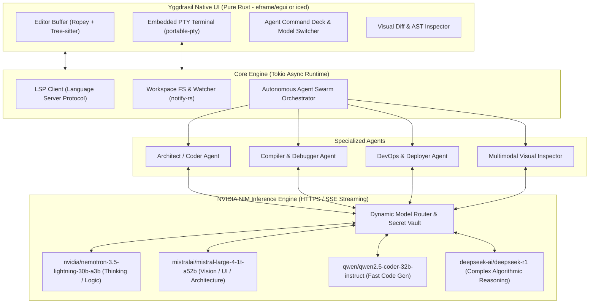

# 🌳 Yggdrasil — Pure Rust AI-Powered Next-Gen IDE

> **Yggdrasil** is an ultra-fast, native, pure Rust-powered Integrated Development Environment (IDE) with an autonomous multi-agent swarm that writes, inspects, debugs, compiles, and deploys software for you. Powered by the free-tier **NVIDIA NIM API** with dynamic model switching (Nemotron, Mistral Large Multimodal, Codestral, Llama 3.3, and DeepSeek R1).

---

## 🏛️ 1. Vision & Architectural Philosophy

Modern IDEs suffer from severe bloat, high memory overhead, and clunky AI plugins tacked on as afterthought webview sidebars. 
**Yggdrasil** is designed from the ground up as a native binary in Rust:
1. **Zero Electron / Zero Webview Bloat**: 100% native Rust GUI rendering at 120+ FPS with sub-millisecond input latency.
2. **Autonomous Multi-Agent Swarm**: Specialized AI agents work directly alongside the developer with first-class editor and terminal primitives.
3. **Free & Switchable NVIDIA NIM Intelligence**: Zero subscription barrier. Leverages NVIDIA's high-speed inference endpoints with zero-cost model switching between reasoning, coding, and multimodal vision models.
4. **Resilient Tool Execution**: Sandboxed local compilation (`cargo`, `rustc`, `gcc`, `npm`), terminal PTY execution, AST-aware diffing, and cloud deployments.



---

## 🤖 2. The Agent Swarm Architecture

Each branch of Yggdrasil represents an autonomous agent persona with dedicated toolsets and prompts:

| Agent Realm | Responsibilities | Tools & Capabilities | Default NIM Model |
|---|---|---|---|
| **Architect / Coder** | Code generation, refactoring, feature implementation, file creation | File read/write, AST query, workspace symbol search, Tree-sitter diffing | `qwen/qwen2.5-coder-32b-instruct` or `meta/llama-3.3-70b-instruct` |
| **Compiler & Debugger** | Error log parsing, clippy warnings, memory profiling, test execution | Run `cargo check / test`, capture compiler output, parse backtraces, patch errors | `nvidia/nemotron-3.5-lightning-30b-a3b` (reasoning_effort: high) |
| **DevOps & Deployer** | Build release binaries, Dockerfile generation, Cloudflare Worker / Vercel deploy, CI/CD | Execute deployment scripts, validate env vars, verify health checks | `mistralai/mistral-large-4-1t-a52b` |
| **Vision Inspector** | UI design matching, Figma/screenshot verification, visual regression testing | Multimodal image processing, CSS/WASM rendering audit | `mistralai/mistral-large-4-1t-a52b` (base64 `image_url`) |

---

## ⚡ 3. NVIDIA NIM Integration & Dynamic Model Switching

The AI backend communicates with `https://integrate.api.nvidia.com/v1/chat/completions` using an OpenAI-compatible JSON schema with extended parameters (`chat_template_kwargs`, `reasoning_effort`, multimodal `image_url` payloads).

### 3.1 Model Payload Specification

```rust
// Rust Serde representation of NVIDIA NIM payload
#[derive(Debug, Serialize, Deserialize)]
pub struct NvidiaChatPayload {
    pub model: String,
    pub messages: Vec<NvidiaMessage>,
    pub max_tokens: u32,
    pub stream: bool,
    pub temperature: f32,
    pub top_p: f32,
    pub frequency_penalty: f32,
    pub presence_penalty: f32,
    #[serde(skip_serializing_if = "Option::is_none")]
    pub reasoning_effort: Option<String>, // "high", "medium", "low"
    #[serde(skip_serializing_if = "Option::is_none")]
    pub chat_template_kwargs: Option<ChatTemplateKwargs>,
}

#[derive(Debug, Serialize, Deserialize)]
pub struct ChatTemplateKwargs {
    pub enable_thinking: bool,
}

#[derive(Debug, Serialize, Deserialize)]
pub struct NvidiaMessage {
    pub role: String, // "system", "user", "assistant"
    pub content: MessageContent,
}

#[derive(Debug, Serialize, Deserialize)]
#[serde(untagged)]
pub enum MessageContent {
    Text(String),
    Parts(Vec<ContentPart>),
}

#[derive(Debug, Serialize, Deserialize)]
#[serde(tag = "type")]
pub enum ContentPart {
    #[serde(rename = "text")]
    Text { text: String },
    #[serde(rename = "image_url")]
    ImageUrl { image_url: ImageUrlObject },
}

#[derive(Debug, Serialize, Deserialize)]
pub struct ImageUrlObject {
    pub url: String, // "data:image/png;base64,..."
}
```

### 3.2 Dynamic Model Switcher Matrix

```
┌──────────────────────────────────────┬──────────────────────┬─────────────────────────┐
│ Task Type                            │ Target NIM Model     │ Reasoning / Vision Mode │
├──────────────────────────────────────┼──────────────────────┼─────────────────────────┤
│ Complex Deep Reasoning & Logic       │ nemotron-3.5-30b     │ enable_thinking: true   │
│ UI Inspection & Screenshot Auditing  │ mistral-large-4-1t   │ reasoning_effort: high  │
│ High-Speed Code Autocomplete         │ qwen2.5-coder-32b    │ stream: true, temp: 0.2 │
│ Large-Scale Architecture & Refactor  │ llama-3.3-70b        │ temp: 0.4, tokens: 8192 │
│ Math & Algorithmic Bug Hunting       │ deepseek-r1          │ stream: true            │
└──────────────────────────────────────┴──────────────────────┴─────────────────────────┘
```

---

## 🛠️ 4. Tech Stack & Crate Ecosystem

| Component | Pure Rust Solution | Why Selected |
|---|---|---|
| **GUI Framework** | `eframe` / `egui` (or `iced`) | Instant 120 FPS rendering, zero C++ bindings, lightweight cross-platform binary |
| **Text Buffer Engine** | `ropey` | Fast O(log N) line/char indexing and concurrent edits on gigabyte files |
| **Syntax Highlighting** | `tree-sitter` & `tree-sitter-highlight` | Real-time incremental AST parsing and syntax highlighting |
| **Terminal / PTY** | `portable-pty` | Native Windows ConPTY + Unix PTY support for running interactive shells |
| **Async Runtime** | `tokio` (multi-threaded) | Industry standard for network I/O, file watching, and background tasks |
| **HTTP & Streaming** | `reqwest` (with `eventsource-stream`) | Fast SSE streaming from NVIDIA NIM API |
| **File Watcher** | `notify` | Real-time filesystem delta updates for open projects |
| **Serialization** | `serde` + `serde_json` | High-performance JSON parsing for NIM payloads |
| **Key Storage** | `keyring-rs` | Secure OS-level credential vault (Windows Credential Guard / Keychain) |

---

## 🗺️ 5. Implementation Roadmap

### Phase 1: Foundation & Pure Rust Editor Core
- [ ] Initialize Cargo workspace (`yggdrasil-core`, `yggdrasil-gui`, `yggdrasil-agent`, `yggdrasil-nim`)
- [ ] Implement `eframe/egui` multi-panel docking window system:
  - Left: Project file tree
  - Center: Multi-tab code editor with line numbers and cursor tracking
  - Right: AI Agent Swarm Dock & Model Selector
  - Bottom: Embedded PTY Terminal and Compiler Output
- [ ] Integrate `ropey` buffer management with basic keyboard shortcuts (Ctrl+S, Ctrl+P, Ctrl+Z)
- [ ] Hook up `tree-sitter` for Rust, JavaScript/TypeScript, Python, and Markdown

### Phase 2: NVIDIA NIM Engine & Model Switcher
- [ ] Implement `NvidiaClient` with support for streaming SSE responses
- [ ] Model selector dropdown in UI with one-click switching (Nemotron, Mistral Large, Qwen Coder, Llama 3.3, DeepSeek R1)
- [ ] Implement multimodal support: drag & drop screenshot/image into chat dock -> auto-encode to Base64 `image_url`
- [ ] Safe credential management: input API key once, stored in OS keyring (`NVIDIA_API_KEY`)

### Phase 3: Autonomous Agent Workflows
- [ ] **Coder Agent**:
  - Takes prompt -> generates file diff -> interactive side-by-side diff review -> Accept/Reject
- [ ] **Debugger Agent**:
  - Triggers `cargo check` / `cargo test` in background
  - Parses stderr diagnostics into file coordinates and severity
  - Proposes 1-click automatic fix directly inside the editor
- [ ] **Deployer Agent**:
  - Presets for Cloudflare Workers (`wrangler`), GitHub Pages, Docker, and Cargo release
  - One-click build & deploy pipeline with real-time log streaming

### Phase 4: Developer Experience & Polish
- [ ] Command Palette (`Ctrl+Shift+P`) for rapid action execution
- [ ] Custom themes (Catppuccin, Tokyo Night, Nord, Gruvbox)
- [ ] Agent token counter and latency tracker (time-to-first-token & tokens/second)
- [ ] Git status integration (dirty file indicators, branch switch, commit dialogue)

---

## 🔒 6. Security & Privacy

1. **Local-First Execution**: Code is stored, edited, and compiled strictly on the local machine.
2. **API Key Isolation**: Keys are never written to plain-text configs or git repositories. Stored encrypted via `keyring-rs`.
3. **Explicit Tool Permissions**: Any file overwrite, command execution, or deployment requires explicit user approval or runs in confirmed sandboxed mode.
